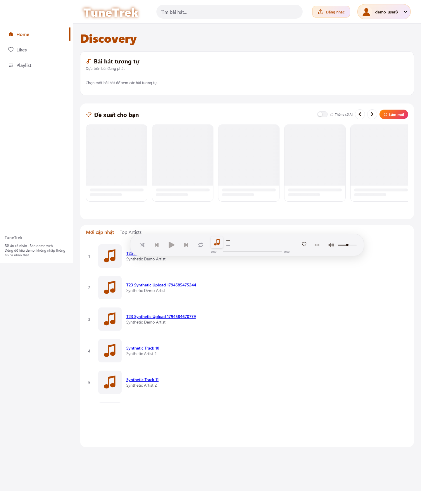

# TuneTrek — website nghe nhạc và recommendation

Đồ án cá nhân của **LE DINH BAO** (chủ dự án xác nhận ngày 2026-11-15). Người nghe có thể khám phá nhạc, quản lý library/playlist và xem gợi ý; quản trị viên kiểm soát nội dung upload trước khi công khai. [Release portfolio-v1](https://github.com/DifnhBao/PROJECT_ThucTapCoSo/releases/tag/portfolio-v1) là nơi chốt SHA, CI và kết quả nghiệm thu; khi chưa có tag, source này là ứng viên đang kiểm tra.

## Demo và showcase

- [Mở demo HTTPS](https://release-mechanisms-charles-gather.trycloudflare.com/Home) — chỉ hoạt động khi máy chủ cá nhân, Docker và tunnel chạy; URL có thể đổi. Không phải hosting 24/7 trên Render.
- [Video walkthrough](docs/showcase/assets/walkthrough.mp4), [ảnh desktop](docs/showcase/assets/desktop.png), [ảnh mobile](docs/showcase/assets/mobile.png).
- [Hướng dẫn demo, tài khoản riêng và mở/dừng tunnel](docs/deployment/LOCAL_HTTPS_DEMO_VI.md). Không chia sẻ file credentials; không nhập thông tin cá nhân/mật khẩu thật vào demo.



## Chức năng đã có bằng chứng

- Guest khám phá/tìm kiếm/phát bài approved + visible; link trực tiếp theo ID.
- User đăng nhập/refresh/logout, favorite/rating, playlist có kiểm tra owner, profile/avatar và upload pending.
- Player queue/shuffle/repeat/seek; finalize listening có UUID, receipt và transaction chống cộng view lặp khi retry.
- Admin preview/approve/reject/hide; media mới qua authenticated Cloudinary gateway.
- Recommendation Node có explanation, snapshot rebuild và fallback public; BA docs truy vết yêu cầu → API → DB → tests.

Không quảng bá Following, Daily Mix tự động, comment, forgot password hoặc Python serving là chức năng đã ship. Score recommendation không phải xác suất thích.

## Kiến trúc và tradeoff

| Thành phần | Vai trò |
|---|---|
| Next.js / React | UI và reverse proxy /api cùng origin |
| Express modular monolith | Auth, policy, catalog/library, listening, upload và recommendation |
| MySQL 8 | Session/receipt/transaction, dữ liệu nghiệp vụ và active snapshot |
| Cloudinary | Asset authenticated; API kiểm tra publication trước stream |
| Python experiments | Nghiên cứu riêng; không nằm trên đường phục vụ chính |

Giữ monolith để transaction/rule dễ kiểm chứng; chưa có bằng chứng tải cần microservices/Redis. [Kiến trúc/ERD](docs/releases/architecture.md), [tradeoffs](docs/product/README.md), [schema/migrations](docs/DATABASE_SETUP_VI.md), [API contract](docs/API_CONTRACT_VI.md).

## Chạy từ checkout sạch

Runtime đã kiểm chứng: Node 22.19.0, Docker Desktop Linux containers. Từ root:

```powershell
npm ci --prefix Server
npm ci --prefix UI
npm --prefix Server test
npm --prefix UI test
```

Để chạy **toàn ứng dụng với DB mới**, tạo root `.env` từ `.env.example` khi chưa có file; điền password app/root/migrator riêng, JWT secrets ngẫu nhiên khác nhau và Cloudinary credentials của bạn. Không ghi đè env đang dùng. Xem [bảng biến và topology](docs/CONFIGURATION_SETUP_VI.md).

```powershell
docker compose config --quiet
docker compose up -d --build --wait --wait-timeout 240
docker compose --profile demo run --rm --build seed
```

Seed chỉ dùng một lần trên DB demo rỗng và cần DEMO_SEED_PASSWORD đã điền. Mở http://localhost:3000/Home. Seed dùng tone 440Hz tự sinh; upload thật cần Cloudinary thật. Không import SQL dump cá nhân. Cách migrate nâng cấp, backup/restore và dừng stack ở [operations](docs/OPERATIONS_VI.md).

Chạy trực tiếp trên host là phương án khác: [config/env](docs/CONFIGURATION_SETUP_VI.md), [database setup](docs/DATABASE_SETUP_VI.md). Next cần API_INTERNAL_URL trong UI/.env.local khi build. Không suy rằng cài npm dependencies đã tạo database.

Trên máy đã thiết lập T23, `node scripts/deploy/tunnel-demo.cjs start|status|stop` điều khiển bản demo đã pin image; lệnh này không phải bootstrap cho một máy vừa clone. Không seed/reset khi mở lại tunnel.

## Kiểm thử và CI

[CI candidate 7011841](https://github.com/DifnhBao/PROJECT_ThucTapCoSo/actions/runs/43458972978): sáu job đạt; backend 125 tests, UI 58 tests theo [T23](docs/verification/T23.md). Integration/E2E CI dùng MySQL mới, storage mock; smoke HTTPS T23 đã kiểm tra Cloudinary thật. Kết quả gắn với commit và môi trường đó, không bảo đảm mọi thay đổi sau này đều đạt.

```powershell
npm --prefix UI run check
npm --prefix Server run lint
```

Build UI trên host cần API_INTERNAL_URL như hướng dẫn trên; backend lint dùng ESLint đã cài trong UI. Full DB/browser suite có guard và opt-in riêng: [testing](docs/TESTING_VI.md). Không chạy integration vào DB demo/cá nhân.

## Kết quả đo và giới hạn

- Player Profiler: list commits **20/20/20 → 0/0/0** với 20 timeupdate/lượt; slider vẫn cập nhật. Đây là React development fixture, không phải phần trăm tăng tốc production. [Protocol/evidence T18](docs/performance/README.md).
- Recommendation test/all synthetic, K=5: Popularity Recall 0.3000; Content-only và Hybrid cùng 0.8000. Hybrid **chưa cải thiện** so với Content-only trong fixture. Không suy retention/traffic hay chất lượng người dùng thật. [Dataset, split, config và kết quả T15](docs/evaluation/README.md).
- HTTPS listener/moderation, restart, DB outage, restore DB riêng và API rollback đã smoke theo [T23](docs/verification/T23.md). Máy/tunnel phải online; SQL backup không chứa asset provider.
- Moderate dependency findings và JWT lịch sử cũ được ghi nhận; xem [triage](docs/security/CI_RISK_TRIAGE_VI.md). T25 sửa điều hướng đăng nhập trực tiếp về Home, gỡ badge store và branding không phù hợp; kết quả kiểm tra cuối nằm trong [checklist phát hành](docs/releases/portfolio-v1-checklist.md).

## Đóng góp và quyền sử dụng

Chủ dự án xác nhận đây là đồ án cá nhân, không ghi thành đồ án nhóm. [Bản nháp CV có evidence](docs/showcase/CV_VI.md) và [phạm vi đóng góp](docs/showcase/CONTRIBUTION_VI.md). Các số đo là kết quả kiểm chứng kỹ thuật, không phải kinh nghiệm vận hành production traffic.

Source do tác giả sở hữu: [MIT](LICENSE), theo lựa chọn của chủ dự án. Dependency, artwork và dữ liệu bên thứ ba giữ điều kiện riêng; [attribution và inventory](docs/showcase/ATTRIBUTION.md). Không coi quyền source của tác giả là quyền phân phối mọi media/dataset cũ trong repo.

## Tài liệu kỹ thuật

- [Hướng dẫn cấu hình và dữ liệu local](docs/CONFIGURATION_SETUP_VI.md)
- [Scope portfolio-v1](docs/PORTFOLIO_V1_SCOPE_VI.md)
- [Thứ tự thực hiện và nghiệm thu](docs/INTERN_PORTFOLIO_EXECUTION_PLAN_VI.md)
- [Báo cáo T03](docs/verification/T03.md)
- [Migrations, seed và MySQL tests](docs/DATABASE_SETUP_VI.md)
- [API contract và validation](docs/API_CONTRACT_VI.md)
- [Báo cáo T05](docs/verification/T05.md)
- [Vòng đời phiên và hướng dẫn nâng cấp](docs/SESSION_LIFECYCLE_VI.md)
- [Báo cáo T06](docs/verification/T06.md)
- [Quota, cookie/origin và trusted proxy](docs/SECURITY_POLICY_VI.md)
- [Báo cáo T07](docs/verification/T07.md)
- [Upload, idempotency và cleanup recovery](docs/UPLOAD_LIFECYCLE_VI.md)
- [Báo cáo T08](docs/verification/T08.md)
- [Playlist transaction và concurrency](docs/PLAYLIST_CONCURRENCY_VI.md)
- [Báo cáo T09](docs/verification/T09.md)
- [Player queue và phục hồi audio](docs/PLAYER_BEHAVIOR_VI.md)
- [Báo cáo T10](docs/verification/T10.md)
- [Listening event contract và delivery](docs/LISTENING_EVENTS_VI.md)
- [Báo cáo T11](docs/verification/T11.md)
- [HTTP, refresh và cache theo tài khoản](docs/HTTP_ACCOUNT_CACHE_VI.md)
- [Báo cáo T12](docs/verification/T12.md)
- [Quality gates và các cảnh báo còn lại](docs/QUALITY_GATES_VI.md)
- [Báo cáo T13](docs/verification/T13.md)
- [Khu vực nghiên cứu Python](experiments/README.md)
- [Recommendation v1 và rebuild snapshot](docs/RECOMMENDATION_ENGINE_VI.md)
- [Báo cáo T14](docs/verification/T14.md)
- [Đánh giá recommendation: protocol, baselines và kết quả synthetic](docs/evaluation/README.md)
- [Báo cáo T15](docs/verification/T15.md)
- [Routes và trạng thái giao diện](docs/PAGE_FLOWS_VI.md)
- [Báo cáo T16](docs/verification/T16.md)
- [Responsive và accessibility T17](docs/verification/T17.md)
- [Frontend performance T18](docs/performance/README.md)
- [Nghiệm thu T18](docs/verification/T18.md)
- [Chạy regression/integration/E2E](docs/TESTING_VI.md)
- [Nghiệm thu T19](docs/verification/T19.md)
- [Docker và operations runbook](docs/OPERATIONS_VI.md)
- [Nghiệm thu T20](docs/verification/T20.md)
- [CI và release/rollback](docs/RELEASE_VI.md)
- [Nghiệm thu T21 — CI GitHub red → green](docs/verification/T21.md)
- [Tài liệu nghiệp vụ: use cases, quyền, rules, KPI và traceability](docs/product/README.md)
- [Nghiệm thu T22](docs/verification/T22.md)
- [Demo HTTPS miễn phí từ máy cá nhân — T23](docs/deployment/LOCAL_HTTPS_DEMO_VI.md)

