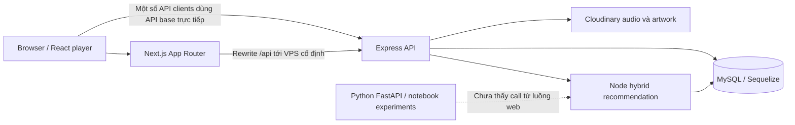

# Technical Audit & Lộ trình nâng cấp TuneTrek

Ngày hoàn tất: **16/10/2026 — Asia/Saigon**. Đối tượng: portfolio **Full-stack Developer Intern / Business Analyst**.

## Kết luận điều hành

**Hiện tại dự án chưa sẵn sàng production. Điểm tổng hợp: 3,6/10**, trung bình đều của sáu khía cạnh bên dưới. Đây là đánh giá mức trưởng thành kỹ thuật của snapshot source hiện tại, không phải đánh giá năng lực cá nhân hay chứng nhận bảo mật.

Dự án có nền đáng giữ: phân lớp Express, schema quan hệ, transaction ở luồng tạo bài hát, player tách service/audio hook, optimistic like có rollback, trạng thái tải của recommendation, và một engine khuyến nghị kết hợp nội dung/hành vi có explanation. Không cần viết lại toàn bộ hoặc chuyển sang microservices.

Các điểm chặn phát hành là **admin thường có thể reset mật khẩu super admin**, kiểm soát trạng thái duyệt bài hát không nhất quán, hoạt động nghe nhạc được báo thành công trước khi lưu bền vững, lỗi queue/player, và quality gates đang bị bỏ qua. Câu chuyện “AI recommendation” cũng cần chỉnh lại: luồng web hiện dùng engine Node; Python và benchmark chưa cung cấp bằng chứng đánh giá đáng tin cậy.

### Phạm vi và cách kiểm chứng

- Kiểm kê cấu trúc 403 file được Git theo dõi; đọc cấu hình, entrypoint, route, controller, service, model, migration, UI hooks/components, Python pipelines, benchmark và các fixture đang có trong working tree.
- Đối chiếu luồng đang được route/import tới với module legacy. Không coi code chết là bằng chứng endpoint production đang crash.
- Chạy TypeScript, ESLint, npm dependency audit cho cả hai package và `docker compose config --services`.
- Tái hiện riêng logic reset-password, shuffle và recommendation fallback/debug bằng source thật với dependency/model mock trong bộ nhớ; không ghi database hoặc gọi API production.
- Không khởi động toàn bộ stack, chạy migration/seed, load test, Lighthouse, pentest live hoặc xác minh uptime của các domain được ghi trong source. Nhận xét mobile dựa trên CSS, chưa phải kiểm thử thị giác trên trình duyệt.
- File `.env` hiện tại được kiểm tra trạng thái Git và tên biến; không công bố giá trị bí mật. Kiểm tra lịch sử chỉ bao phủ các ref/path cục bộ đã kiểm tra, không chứng minh mọi secret trong toàn bộ lịch sử đều sạch.
- Working tree đã có thay đổi trước audit, gồm `.env.example` bị xóa, `UI/UI.zip`, `UI/hash.js`, các seed/dump chưa tracked. Audit không sửa hoặc khôi phục những thay đổi đó.

### Kết quả chạy công cụ

| Kiểm tra | Kết quả thực tế | Giới hạn diễn giải |
|---|---|---|
| `UI: tsc --noEmit --incremental false` | **Thất bại, 2 lỗi**: `MusicDataContext.tsx:3` không có export `Artist`; `mixService.ts:1` import `axiosClient` không tồn tại | Hai module có dấu hiệu legacy; không kết luận route đang sử dụng chúng bị crash |
| `UI: npm run lint` | **72 errors, 76 warnings / 116 file**; 68 báo cáo `no-explicit-any`, 36 `no-img-element`, 31 `no-unused-vars`, 6 dependency hooks | Đây là số báo cáo lint, không phải số lỗ hổng hay điểm Lighthouse |
| `UI: npm audit --omit=dev` | **9 package bị ảnh hưởng**: 1 critical, 6 high, 2 moderate | Là đối chiếu dependency graph; cần xem điều kiện khai thác từng advisory |
| `Server: npm audit --omit=dev` | **11 package bị ảnh hưởng**: 1 critical, 5 high, 4 moderate, 1 low | Không đồng nghĩa đã có 11 đường khai thác trong app |
| `docker compose config --services` | Chỉ trả về **`db`** | Compose hiện không chạy UI/API/AI |
| Mock actual password-reset service | Admin requester đã gọi được `save()` trên target super_admin | Kiểm chứng logic; không đổi mật khẩu tài khoản thật |
| Mock actual shuffle service | Queue `[1,2,3]`, current `1`, RNG cố định: bật shuffle làm current thành `2` | Audio/UI không được đổi tương ứng bởi toggle |
| Mock actual recommendation service | Catalog không có approved: trả pending; public debug trả audio URL pending | Kiểm chứng logic với fixture, không probe live |

Bằng chứng máy đọc được: [ESLint](evidence/ui-eslint.json), [UI npm audit](evidence/ui-npm-audit.json), [Server npm audit](evidence/server-npm-audit.json), [ghi chú kiểm chứng](evidence/verification.md). Source text trong JSON ESLint đã được bỏ để tránh sao chép nội dung file không cần thiết.

## PHẦN 1 — ĐÁNH GIÁ HIỆN TRẠNG HỆ THỐNG

### Bản đồ kiến trúc thực tế



Stack thực tế còn có **Cloudinary, Sequelize, Python/FastAPI/TensorFlow/scikit-learn**. MongoDB xuất hiện trong code nghiên cứu, nhưng kết nối MongoDB ở live Node đã bị comment (`Server/src/server.js:10,65`); hoạt động nghe hiện được ghi MySQL. Không nên giới thiệu MongoDB/Python như thành phần production đã tích hợp nếu chưa hoàn thành contract và đường gọi.

| Khía cạnh | Điểm /10 | Điểm tốt | Điểm chặn chất lượng |
|---|---:|---|---|
| Architecture & Code Quality | **4,5** | Routes/controllers/services/models, feature modules, audio hook riêng | Build che lỗi type; nhiều API clients/module legacy; recommendation service ôm nhiều nhiệm vụ |
| Security & Data Integrity | **2,5** | Bcrypt, JWT, HttpOnly cookies, CORS allowlist, một số ownership checks | Leo quyền đã tái hiện; thiếu object authorization; public debug; session lifecycle và telemetry yếu |
| Database & API Design | **4,0** | N–N, FK/unique indexes, transaction tạo bài | Schema drift, race playlist, query amplification, response/status không thống nhất |
| Error Handling & Edge Cases | **3,5** | Có global middleware, một số fallback/rollback | Phân loại lỗi theo chuỗi, lộ internal errors, readiness sai, player retry không giới hạn |
| UI/UX & Frontend Performance | **4,0** | Skeleton recommendation, search debounce, optimistic like | Core playback lỗi, mobile CSS không khớp, states và accessibility thiếu, số liệu giả |
| DevOps & CV-Readiness | **3,0** | Có lockfiles, Dockerfiles, migrations và demo fixtures | Không README root/CI/test suite; Compose chỉ DB; benchmark không đo đúng tên |

### 1. Architecture & Code Quality

**A1. Quality gate bị vô hiệu hóa.** `UI/next.config.ts:4-5` bật `typescript.ignoreBuildErrors: true`, trong khi `UI/tsconfig.json:7` khai báo strict. Hai lỗi type thực tế ở `UI/app/context/MusicDataContext.tsx:3` và `UI/app/features/mix/mixService.ts:1` bị build bỏ qua. `UI/package.json:16,28` còn lệch major giữa Next 16 và eslint-config-next 15. Kết quả lint 72 errors là bằng chứng có thể kiểm tra lại, không phải nhận xét cảm tính về code style.

**A2. Một frontend có nhiều cơ chế HTTP/auth.** `UI/app/lib/http.ts:3-75` dùng Axios interceptor, `UI/app/utils/refreshToken.ts` dùng fetch-refresh, activity logger dùng raw Axios (`UI/app/features/player/hook/useActivityLogger.ts:71`). Refresh queue ở `lib/http.ts:15-19` dùng chung cho user và admin dù cookie/scope khác nhau. Config API ở `lib/http.ts:5` fallback localhost, còn `next.config.ts:11` rewrite về VPS HTTP cố định. Deploy dễ có client gọi sai origin; một nhánh refresh không sửa được nhánh khác.

**A3. Ranh giới module có nhưng chưa được giữ.** `Server/src/controllers/song.controller.js:41-168` vừa kiểm tra user/profile, xử lý cloud upload, vừa điều phối nghiệp vụ; activity controller chứa buffer, scheduler và persistence. `Server/src/services/recommendation/recommendation.service.js` chứa serving, fallback, lý do gợi ý và debug. Nên tách theo use case và adapter storage/clock/queue để kiểm thử failure paths; không cần thêm repository chỉ để đổi tên mọi lệnh Sequelize.

**A4. Code legacy gây nhiễu quá trình review.** `Server/src/services/user_activity.service.js:1` import model Mongo không tồn tại nhưng live route dùng controller MySQL; `song.service.js:305` có `getSongById` thiếu await và dùng `Album` chưa export nhưng không được route gọi. `UI/app/features/mix/mix.api.ts` rỗng, `songsService.ts` toàn comment; `Player.tsx:279` trở đi giữ JSX cũ. Chuyển nghiên cứu sang `experiments/`, bỏ dead imports sau kiểm tra dependency graph.

**A5. State player cập nhật quá rộng.** `useAudioEngine.ts:37-44` cập nhật currentTime; `PlayerContext.tsx:265-286` cung cấp progress, queue, actions trong cùng context value. Các danh sách như `TrackSection.tsx:12`, `RecommendationSection.tsx:70`, `LibraryTable.tsx:11` subscribe cùng context. Đây là nguồn rerender không cần thiết có căn cứ từ code; chưa có số đo CPU/FPS để định lượng tác động.

### 2. Security & Data Integrity

**S1 — Blocker: admin thường reset được mật khẩu super_admin.** `Server/src/services/user.service.js:257` so sánh:

```js
const isSelf = targetUser.id === requester.user_id;
```

Model khai báo `user_id` (`models/user.model.js:8`); JWT principal khai báo `userId` (`services/auth.service.js:191`). Trong luồng thực tế, hai thuộc tính trên đều undefined, nên `isSelf` thành true. Route `PUT /api/users/:id/reset-password` cho admin vào (`routes/user.routes.js:85-89`), và nhánh policy bỏ qua kiểm tra cấp bậc target khi được coi là self. Mock source service đã xác nhận admin có thể lưu password của target super_admin. Cần sửa identity mapping và có regression test toàn bộ requester-role × target-role × self/other.

**S2 — BOLA: truy cập recommendation của user khác.** `routes/recommendation.routes.js:18` có `protect` nhưng `controllers/recommendation.controller.js:62-69` tin `userId` từ URL. Người đăng nhập có thể yêu cầu recommendations của tài khoản khác; explanation còn có thể nói tới bài làm seed. Đổi public user API sang `/recommendations/me`, lấy principal từ middleware. Quyền admin xem user khác phải được kiểm tra riêng.

**S3 — Nhạc pending/hidden đi qua policy không nhất quán.** `recommendation.service.js:803-809` bỏ `status:'approved'` trong fallback khi tập approved rỗng. Debug route công khai ở `recommendation.routes.js:20-21`; `recommendation.service.js:848-856` lấy bài bất kỳ cùng audio URL. `playlist.service.js:28,60` chỉ kiểm tra tồn tại và trả association Song mà không lọc publication. Phải dùng một public-song scope xuyên search/detail/playlist/favorite/recommendation, không chỉ UI. Khả năng truy cập playlist private cũng chưa bị chặn ở detail dù model có `is_public`; việc đang có private records thật chưa được kiểm tra.

**S4 — Refresh token có lỗi thiết kế lưu trữ và thu hồi.** `refresh_token.model.js:15` là VARCHAR255, nhưng `auth.service.js:82-85` lưu JWT thô. Username dài 100 ký tự được model cho phép; thử ký với dummy secret sinh refresh JWT 333 ký tự. Login có thể lỗi insert/truncation tùy SQL mode. Payload giống nhau trong cùng giây có thể tạo token giống nhau và đụng unique token. Password change/reset (`user.service.js:61-87,251-300`) không revoke refresh tokens; role trong access token còn được tin tới khi hết hạn. Dùng opaque random refresh token, lưu digest, rotation/reuse detection và revoke theo session/password/role policy.

**S5 — Tình trạng secrets và dữ liệu cần mô tả đúng.**

- `Server/.env` tồn tại và được ignore; không nằm trong tracked files hiện tại. Lịch sử Git của các path `.env` được kiểm tra không trả commit. Chưa có bằng chứng để kết luận file này đã được commit, cũng chưa có full-history secret scan.
- `Benchmark/benchmark.js:40` có bearer JWT literal. Payload cho biết hết hạn **18/06/2026 UTC**; không gọi nó là access token còn hoạt động. Xóa khỏi source và lấy credential test từ runtime.
- `UI/hash.js:3` hardcode password dùng cho script; chưa chứng minh là credential production. Không dùng script kiểu này trong demo/public setup.
- `db/init.sql:437` chứa user records với email/điện thoại/địa chỉ/ngày sinh và bcrypt hashes, không chứng minh toàn bộ là dữ liệu giả. Thay bằng synthetic seed; không phát hành dump này như dữ liệu demo. Nếu xác nhận dữ liệu/credential thật từng public, xử lý thu hồi/xóa lịch sử có phối hợp.
- `docker-compose.yml:8` hardcode mật khẩu root dễ đoán; `:11` publish MySQL ra host. Local dev nên bind localhost và dùng app user riêng; production không public DB port.

**S6 — Validation và chống abuse còn thiếu.** `song.controller.js:209-210,336` chưa ràng buộc page/limit/q đúng kiểu và max size; `.trim()` với q không phải string có thể trả500. `user_activity.controller.js:44-53` chưa validate chặt event payload. Không thấy rate limiter ở entrypoint/routes; ưu tiên login, upload, activity và các endpoint tính toán nặng. `upload.midleware.js:22-33` có MIME allowlist và giới hạn10MB, nhưng MIME do client khai báo; cần kiểm tra signature/metadata file, quota và cleanup.

**S7 — Dependencies cần vá có kiểm chứng.** Lockfile dùng Next16.1.1 (`UI/package-lock.json:4097`), Axios1.13.2 (`:1861`); Multer2.0.2 (`Server/package-lock.json:1601`), MySQL2 3.16.0 (`:1662`), Sequelize6.37.7 (`:2113`). Audit trả các cảnh báo như bảng ở đầu báo cáo. Ví dụ xác nhận với nguồn maintainer: [Multer malformed-request DoS](https://github.com/expressjs/multer/security/advisories/GHSA-5528-5vmv-3xc2), [Next.js request smuggling trong rewrites](https://github.com/vercel/next.js/security/advisories/GHSA-ggv3-7p47-pfv8), [Sequelize JSON-column cast SQL injection](https://github.com/sequelize/sequelize/security/advisories/GHSA-6457-6jrx-69cr). Cảnh báo Sequelize không chứng minh app đang đưa input vào đường cast dễ bị tấn công; các critical cũng phụ thuộc runtime/config. Advisory rewrite của Next nói rõ trường hợp provider xử lý rewrite ở CDN như Vercel không bị ảnh hưởng bởi chính lỗi đó; chưa xác minh topology live của dự án. Nâng lên bản đã vá toàn bộ advisory liên quan tại thời điểm triển khai, update lockfile và chạy regression; không dừng ở version vá của một advisory cũ, không dùng `audit fix --force` mù quáng.

**Những điều không nên kết luận quá mức:** query ORM hiện chưa cho bằng chứng SQL injection trực tiếp; chưa tái hiện XSS. Cookie đã có HttpOnly/Secure/SameSite=None (`auth.controller.js:35-46`). Server chủ động từ chối Origin ngoài allowlist trước routes (`server.js:30-34`), nên thiếu CSRF token riêng không đủ để tuyên bố đã khai thác được CSRF. Cần ghi rõ chiến lược same-site/cross-site, kiểm thử origin và bổ sung CSRF/Fetch Metadata thích hợp cho topology cuối cùng.

### 3. Database & API Design

**D1. Schema có nền quan hệ tốt, nhưng nhiều nguồn sự thật.** Có bảng nối song_artists/song_genres/playlist_songs, unique rating/favorite theo user-song, FK và cascade. Tuy nhiên `docker-compose.yml:14` nạp `db/init.sql`; dump này thiếu `song_similarities`, trong khi root `init.sql:367` có. Server `models/index.js:157-164` chỉ authenticate, không tự chạy migrations dù tên hàm là syncDatabase. Clone rồi Compose hiện không đảm bảo schema dùng được cho recommender. Chọn migrations làm canonical schema và một synthetic seed riêng.

**D2. Migration ownership cần làm sạch.** Initial migration đã tạo genres/song_genres; `20260426151349-add-genres-and-song-genres.js:7,25` tạo lại, down ở `:55-56` xóa các bảng đã thuộc migration đầu. Không khẳng định fresh migrate chắc chắn lỗi duplicate table: Sequelize MySQL generator hiện dùng CREATE TABLE IF NOT EXISTS. Vấn đề là ownership/rollback và khả năng chứng minh fresh setup. Với database đã triển khai, dùng migration sửa tiến về phía trước; chỉ squash baseline khi đã quyết định reset database demo.

**D3. Playlist có race condition.** `playlist.service.js:44-55` đọc max(position), rồi create ngoài transaction/lock. Hai request thêm hai bài cùng lúc có thể chọn cùng position; unique `(playlist_id,position)` trong migration `20260507034124...:49-55` khiến một request lỗi. Khóa parent playlist trong transaction khi append/reorder; trả409 cho conflict phù hợp. Delete join rows rồi parent ở `playlist.service.js:130-136` cũng thiếu atomicity; có thể tận dụng cascade đã có.

**D4. Query amplification và all-pairs storage là giới hạn chính.** Serving ở `recommendation.service.js:593-599` chờ query từng seed; fallback `:213,231-233` lấy catalog rồi metadata từng bài. Rebuild ở `hybridSimilarity.service.js:234-235,265-268` có N metadata lookups và N² cặp; `:261,312` chạy hàng trăm upsert riêng đồng thời. Lưu hai chiều tạo N(N−1) hàng: 10.000 bài tương ứng gần100 triệu hàng, đây là tính toán lý thuyết, chưa phải load-test result. Lưu top-K neighbors, batch metadata và chuyển rebuild thành job có model_version/atomic publication.

**D5. Index đã có, cần thiết kế theo query và đo.** Migration song similarities có unique pair cùng các index riêng song_id_1/song_id_2/final_score. Query lọc một seed và sort score (`recommendation.service.js:165-167`) là ứng viên cho composite `(song_id_1, final_score, song_id_2)`; khi versioning có thể thêm model_version ở đầu theo query. Dùng EXPLAIN ANALYZE và dataset đại diện trước/sau, không khẳng định latency giảm khi chưa đo. Activity cần index phù hợp truy vấn user/time và chiến lược partition/retention; hiện migration `20260512075542...:37-49` mới có partition năm2026 và pMax.

**D6. API chưa có contract thống nhất.** Song list trả `{page,limit,total,songs}` (`song.service.js:340`), playlist `{success,data}`, auth `{message,data}`, rating shape riêng. `playlist.controller.js:63` trả200 với data null; một số ownership/duplicate được catch thành500. Chuẩn hóa success/error envelope và pagination, status400/401/403/404/409/422/429 theo contract; DELETE204 thì không kèm body. OpenAPI và generated/shared DTO sẽ ngăn API mapper lệch schema.

### 4. Error Handling & Edge Cases

**E1. Có global error middleware nhưng phân loại theo câu chữ.** `server.js:49-50` đã mount middleware. `error.midleware.js:29-57` map lỗi qua substring tiếng Việt; `:63` trả internal message cho client, bỏ qua error status có cấu trúc. `rating.service.js:7` ném câu tiếng Việt nhưng `rating.controller.js:32` chỉ nhận `SONG_NOT_FOUND`, khiến missing song thành500. Dùng AppError với code/status/isOperational; log nội bộ có requestId, response chỉ trả message an toàn và mã lỗi ổn định.

**E2. API “healthy” khi DB chưa sẵn sàng.** `server.js:55` listen trước authenticate ở `:60`; catch ở `:66-68` chỉ log, `/` vẫn trả200. Startup phải fail rõ nếu cấu hình/DB không hợp lệ; readiness kiểm tra dependency, liveness chỉ phản ánh process; graceful shutdown đóng HTTP/pool và chờ tác vụ đang xử lý.

**E3. Activity buffer làm sai tính bền vững dữ liệu.** `user_activity.controller.js:14-19` xóa RAM buffer trước insert; `:29` requeue toàn batch lỗi; `:61` báo thành công trước commit. Invalid event có thể kéo cả batch vào retry; crash mất accepted events, shutdown ở `:71-78` không chờ batch in-flight. Schema chưa có event-id dedupe. Trước mắt write durable trước ACK; chỉ thêm queue khi đã xác định nhu cầu. Nếu dùng queue, ACK sau durable enqueue và consumer xử lý idempotent.

**E4. Upload để lại file/asset mồ côi.** Multer chạy trước controller (`song.routes.js:20-27`); early returns ở `song.controller.js:99-120` không đi qua catch cleanup. Admin create catch ở `:88` chỉ next(err). Audio cloud upload thành công rồi image/DB lỗi cần compensation. Thêm finally cleanup temp, lưu public_id, đánh dấu trạng thái upload và retry/cleanup job có giới hạn.

**E5. Vòng đời transaction tạo bài có góc lỗi.** `song.service.js:243-264` commit rồi hydrate response trong cùng try; lỗi đọc sau commit sẽ rollback transaction đã commit. Tách phần sau commit; không báo transaction đã được undo khi dữ liệu đã ghi thành công. Dùng idempotency cho create/upload khi client có thể retry sau lỗi response.

**E6. Player có hai lỗi core đã xác định.** `playerService.ts:31-37` đổi isShuffle trước khi chụp current track, đã tái hiện lệch bài. `PlayerContext.tsx:41,119-134,169-173` bắt đầu page1 nhưng lấy page2, rồi effect gọi tiếp khi queue còn ít. Khi API lỗi hoặc page rỗng mà total vẫn >0, loadingMore đổi kéo callback/effect chạy lại; có thể lặp requests không có progress. Queue cần state machine/cursor theo source, empty-page termination và bounded retry.

### 5. UI/UX & Frontend Performance

**U1. Mobile layout có xung đột cụ thể.** Sidebar render CSS module `styles.menu` (`Sidebar/UserPage/Sidebar.tsx:18`) với width260px (`Sidebar.module.css:9-10`), nhưng breakpoint trong `globals.css:304-343` chỉnh `.menu` global, không match class đã hash. Main margin đổi còn70px trong khi sidebar/header vẫn offset260px. `Player.css:9` dùng `calc(100% - 280px)`, chỉ còn95px ở viewport375px; chưa có viewport breakpoint trong file này. Đây là bằng chứng CSS cần sửa; xác nhận bằng browser ở375/768/1440px trước khi ghi “responsive complete”.

**U2. Loading/empty/error không được phân biệt ở nhiều luồng.** Recommendation đã có skeleton/error/empty/refresh (`RecommendationSection.tsx:154-193`) — nên giữ và tái dùng. Search catch lỗi thành mảng rỗng (`SearchBar.tsx:36-40`), results báo “Không tìm thấy” cả khi request lỗi. Debounce300ms đã có nhưng chưa ngăn response cũ ghi đè response mới (`:23-45`). Dùng AbortController/request sequence và explicit state. Không thấy route `error.tsx`/`global-error.tsx` trong UI/app.

**U3. Audio error recovery và accessibility thiếu.** `useAudioEngine.ts:72-77` chưa xử lý error/waiting/stalled; play rejection ở `:98-105` không có thông báo cho user. `Player.tsx:126-147` có icon buttons thiếu accessible name; slider `:175,249` thiếu label. `components/ui/Modal.tsx:16-25` thiếu dialog semantics, focus trap/restore và Esc. Dùng native controls/accessible dialog và trạng thái buffering/error/retry/skip.

**U4. Library bị cắt 20 bài và cache không gắn tài khoản.** `LikeContext.tsx:59` luôn tải page1 limit20; LibraryTable không load more. Cache context tồn tại qua logout ở `useLogout.ts:15` và `Pages/layout.tsx:14-18`, không keyed by user. User B trong cùng tab có thể thấy like cache từ A. Dùng SWR đang có trong repo, key theo identity, reset/invalidate khi auth đổi, pagination đầy đủ và toast khi optimistic rollback.

**U5. Telemetry frontend làm sai nguồn nghe.** `useActivityLogger.ts:81-89` đổi sourceRef trước khi flush bài cũ; nguồn mới có thể bị gán cho session cũ. Ended ở `:151-157` xóa session, nhưng repeat branch `PlayerContext.tsx:87-91` chỉ seek/play, không tạo session mới. Điều này làm dashboard attribution và learning signals sai dù không có lỗi UI rõ ràng. Session snapshot phải bất biến; mỗi repeat mở session riêng.

**U6. Demo hiện có các lời hứa chưa thực hiện.** `DetailSong.tsx:81` hardcode “AI Match:98%”; `DetailView.tsx:71` hardcode999K likes; Daily Mix có tab nhưng content bị comment (`FeaturedPlaylists.tsx:58-80`); Following chỉ placeholder (`Following/page.tsx:1-3`). Comment/forgot password/menu report cũng chưa có behavior đầy đủ. Với hiring review, một luồng nhỏ chạy hoàn chỉnh thuyết phục hơn số liệu không có nguồn. Similarity score không mặc nhiên là xác suất người dùng thích bài.

**U7. Deep link không độc lập với player.** `DetailSong.tsx:16` chỉ đọc currentTrack trong context; `Player.tsx:41-49` thay query track theo bài đang phát. Mở link bài ở tab mới không có player state sẽ không tải đúng entity. Tạo `/songs/[id]` và `/playlists/[id]`, fetch dữ liệu theo URL, tách view entity khỏi queue.

**U8. Tối ưu performance phải đi kèm đo.** 36 cảnh báo img chưa đủ để kết luận bundle “nặng”; inventory ảnh/kích thước/lazy loading và remote image config trước. Root layout tải Font Awesome CDN (`app/layout.tsx:15-18`) trong khi package còn Font Awesome/react-icons/lucide. Rà usage rồi giảm icon pipelines, tách progress context, dùng Profiler/bundle analyzer và Lighthouse mobile làm baseline. Chưa có dữ liệu để tuyên bố LCP/INP hoặc phần trăm cải thiện.

### 6. DevOps & CV-Readiness

**O1. Chưa có đường chạy toàn stack lặp lại được.** Compose chỉ DB; Dockerfiles UI/Server dùng `npm install` thay npm ci (`UI/Dockerfile:4`, `Server/Dockerfile:9`), chưa tách runtime image gọn/non-root. AI Dockerfile chạy `Bảo.main:app` (`AI_Services/Dockerfile:13`), README hướng dẫn `python src/main.py` (`README.md:11`) nhưng file đó chỉ có comments. Ba đường entrypoint không mô tả cùng một ứng dụng.

**O2. Thiếu packaging cho reviewer.** Không có README root, CI workflow được tracked hoặc suite unit/integration/E2E cho luồng ứng dụng. `UI/README.md:1` còn template create-next-app; `Server/package.json:8` test script cố tình exit1. Các file test Python/cloud upload và checklist SQL không thay thế suite kiểm thử ứng dụng. Chưa xác minh live demo dù có domain trong allowlist.

**O3. Repository hygiene yếu.** Tracked files hiện khoảng130,8MiB; riêng MP3 khoảng66,0MiB, có nhiều bản upload tạm lặp. `UI/UI.zip`, `AI_Services/pyvenv.cfg`, notebook/model/data snapshot cùng source làm khó phân biệt deliverable với local artifacts. Dùng media demo nhỏ được phép phân phối, object storage/release artifacts hoặc LFS khi cần; giữ provenance/manifest cho model/dataset. Không xóa lịch sử Git hoặc dữ liệu thật tự động trong một task audit.

**O4. Chỉ số benchmark hiện không có giá trị như tên gọi.** `Benchmark/benchmark.js:83-84` coi khớp genre là relevant; `:90-95` lấy từ khóa trong chính explanation làm serendipity; `:117` tính precision rồi `:133-135` đặt trung bình thành MAP@5. MAP cần average precision theo vị trí relevant, không phải mean Precision. Cold start ở `:59-62` in thành công mà không assert output. Giữ script dưới tên synthetic genre-consistency smoke test, không dùng chart hiện tại chứng minh uplift.

**O5. Python evaluation cũng chưa chạy đúng nghĩa.** `scripts/evaluate.py:5` import recommender đang None (`src/api/server.py:18`, chỉ khởi tạo trong lifespan `:53`); `evaluate.py:32` gọi recommend trên biến đó. Sau khi sửa initialization vẫn còn so recommendation dict với integer IDs ở `:44`. Pipeline retrain học toàn final_train_df (`AI_Services/scripts/retrain_pipeline.py:28-34`) trước bước split trong evaluator; chạy theo workflow này gây leakage, nhưng audit chưa xác minh provenance của model binary đã lưu. Dữ liệu còn bị gộp và mất timestamp (`src/data_pipeline/data_processor.py:56`), nên tail(2) không tạo temporal split đáng tin cậy. `src/api/server.py:59-62` còn hardcode liked songs. Phải có pipeline đánh giá thuần, split trước feature/training, baseline và dataset version.

### Những điểm dễ khiến hồ sơ bị đánh giá thấp nhất

1. Demo phân quyền admin nhưng có lỗi admin→super_admin đã tái hiện.
2. Cấu hình build bỏ qua kiểm tra TypeScript, trong khi lint/typecheck thực tế đỏ.
3. Nói AI/NCF chạy production nhưng đường web không gọi Python, benchmark gắn tên metric sai.
4. Repo không có hướng dẫn chạy toàn stack; clone sạch không đảm bảo schema đúng.
5. UI có số liệu98%/999K và các nút/tab chưa hoạt động nhưng không nói rõ đó là mock.

Đây là rủi ro reviewer mất niềm tin, không phải khẳng định mọi nhà tuyển dụng sẽ tự động loại. Sửa những điểm này trước khi bổ sung công nghệ mới.

## PHẦN 2 — ACTIONABLE ROADMAP

Quy ước: **P0** chặn công khai/phát hành; **P1** sửa trước demo portfolio; **P2** chuẩn hóa sau khi các luồng chính ổn; **P3** polish/showcase. Mỗi task dưới đây ghi đủ vị trí → giải pháp → giá trị CV, cùng tiêu chí nghiệm thu để tránh “refactor xong” chỉ bằng cảm giác.

### 🔥 Giai đoạn 1 — Critical Fixes

**F01 — P0: Khóa lỗi leo quyền và truy cập chéo user.**
- **Ở đâu:** S1/S2, `user.service.js:257`, `recommendation.controller.js:62-69`.
- **Giải pháp:** principal chuẩn `{id,role,scope,sessionId}` tại boundary; permission matrix; `/recommendations/me`; target-role check độc lập self; revoke sessions sau reset theo policy.
- **Nghiệm thu:** user/admin/super_admin × self/other có test; admin→super_admin bị403 và password không đổi; userA không đọc recommendations userB.
- **Giá trị CV:** thiết kế RBAC, kiểm soát truy cập theo đối tượng và viết negative security tests.

**F02 — P0: Enforce trạng thái phát hành bài hát ở backend.**
- **Ở đâu:** S3, `recommendation.service.js:808,848`, `playlist.service.js:28,60`, public debug route.
- **Giải pháp:** scope approved+visible chung; debug chỉ admin/dev; kiểm tra playlist public/owner; cân nhắc access policy của media nếu pending phải thực sự private.
- **Nghiệm thu:** pending/rejected/hidden không xuất hiện hoặc trả audio URL qua tất cả public endpoints; catalog rỗng trả empty hợp lệ.
- **Giá trị CV:** mô hình hóa workflow kiểm duyệt và bảo vệ business invariants xuyên nhiều API.

**F03 — P1: Vá dependency và vệ sinh secrets/dữ liệu demo.**
- **Ở đâu:** lockfiles, `Benchmark/benchmark.js:40`, `UI/hash.js:3`, `db/init.sql:437`, Compose.
- **Giải pháp:** cập nhật version đã vá và lockfiles; bỏ token literal; secret scan toàn lịch sử trước public; synthetic seed; app DB user; `.env.example` đủ biến nhưng không có secret thật. Rotate credential nếu xác nhận từng lộ.
- **Nghiệm thu:** scan report có triage rõ cho remaining advisories; không còn credential/PII thật trong deliverable; regression auth/upload sau update pass.
- **Giá trị CV:** quản lý dependency và cấu hình môi trường có quy trình, không chỉ thêm package.

**F04 — P1: Khôi phục quality gates và dọn code chết.**
- **Ở đâu:** A1/A4, hai lỗi tsc, `ignoreBuildErrors`, duplicate API/legacy imports.
- **Giải pháp:** xác nhận dead modules rồi xóa/chuyển experiments; sửa types còn dùng; bỏ ignoreBuildErrors; đồng bộ lint config; một API base theo môi trường, không hardcode VPS.
- **Nghiệm thu:** typecheck/lint/build đều pass trong clone sạch; không disable rule hàng loạt để che lỗi; frontend không gọi localhost từ máy reviewer.
- **Giá trị CV:** build tái lập và kiểm soát chất lượng code tự động.

**F05 — P1: Sửa playback và data delivery trước khi thêm tính năng.**
- **Ở đâu:** E6/U5, `playerService.ts:31`, `PlayerContext.tsx:119`, `useActivityLogger.ts:81`; E3.
- **Giải pháp:** giữ current song khi shuffle; queue cursor theo source; dừng empty pages; retry hữu hạn; snapshot session, log repeat đúng; server validate và commit event trước ACK, dedupe theo eventId.
- **Nghiệm thu:** queue0/1/20/21 bài, shuffle on/off, repeat, đổi playlist, offline/online; không request storm; cùng event gửi2 lần chỉ ghi/tính1 lần; DB down không báo durable success.
- **Giá trị CV:** debugging state machine và thiết kế dữ liệu hành vi đáng tin cậy.

**F06 — P1: Làm auth session và startup hoạt động đúng.**
- **Ở đâu:** S4, E2, token column255, listen-before-authenticate.
- **Giải pháp:** opaque refresh token+digest, TTL nhất quán, rotation/revocation; config validation lúc boot; health/readiness riêng; fail startup khi thiếu DB/config; rate limit login theo IP/account, quota upload/event và giới hạn request tính toán nặng; shared limiter store khi chạy nhiều API instances.
- **Nghiệm thu:** username100 ký tự login được; concurrent login không unique-token collision; password reset thu hồi phiên theo SLA đã định; readiness503 khi DB không sẵn sàng; vượt giới hạn nhận429 và Retry-After, không cho phép bypass quota bằng cách đổi API instance.
- **Giá trị CV:** quản lý session lifecycle và vận hành dịch vụ có kiểm chứng.

**F07 — P1: Làm demo và tuyên bố kết quả trung thực.**
- **Ở đâu:** U6/O4/O5, AI Match98%,999K, Daily Mix placeholder, benchmark.
- **Giải pháp:** bỏ số liệu giả, ẩn feature chưa làm; đổi tên benchmark hiện có thành smoke test; ghi rõ Node engine shipped và Python experimental.
- **Nghiệm thu:** mọi nút trong demo path có hành vi; mọi số trong README có nguồn; không gọi genre consistency là MAP.
- **Giá trị CV:** giải thích giới hạn kỹ thuật và chất lượng bằng chứng, rất quan trọng khi phỏng vấn BA/SWE.

**Cổng hoàn tất giai đoạn1:** không còn P0; các regression trên pass; type/lint/build xanh; happy path đăng ký→nghe→like→playlist→gợi ý và admin upload→duyệt chạy được trong môi trường test.

### 🛠️ Giai đoạn 2 — Refactoring & Standardization

**R01 — Validation + API contract + error taxonomy.**
- **Ở đâu:** S6/E1/D6, controllers và HTTP clients.
- **Giải pháp:** Zod cho params/query/body; limit1–100 theo endpoint, ID integer dương, enum/range event; chuẩn AppError/code/status/requestId; OpenAPI; DTO ở frontend. Dùng `unknown` và narrowing ở catch thay any.
- **Nghiệm thu:** malformed JSON/query/body, missing entities, unauthorized/forbidden/conflict có response/status đúng; internal errors không lộ SQL/config.
- **CV:** API contract rõ, validation ở boundary, integration tests lỗi và edge cases.

**R02 — Canonical migrations, seed và transaction concurrency.**
- **Ở đâu:** D1–D3, schema snapshots và playlist append/delete.
- **Giải pháp:** fresh database→migrations→synthetic seed; repair migrations thay sửa lịch sử deployed; lock parent playlist trong transaction; kiểm tra schema drift; xác định retention và partition maintenance.
- **Nghiệm thu:** CI dựng DB rỗng được; concurrent append không trùng position/mất bài; rollback đúng; fixture không chứa PII thật.
- **CV:** relational modeling, transactional integrity và concurrent-write handling.

**R03 — Chuẩn hóa use-case boundaries, storage và transaction cleanup.**
- **Ở đâu:** A3/E4/E5, song upload/create/update.
- **Giải pháp:** controller chỉ parse/call/respond; use case điều phối validation/domain/storage; Cloudinary adapter; finally cleanup; compensating deletion; tách hydrate sau commit; gộp normalization artist/genre lặp.
- **Nghiệm thu:** mock image upload fail/DB fail/client retry không tạo file rác hoặc duplicate song; error sau commit không rollback transaction đã đóng.
- **CV:** xử lý partial failure giữa DB và external service, tách dependency để test.

**R04 — Một HTTP client và server-state cache theo identity.**
- **Ở đâu:** A2/U4, `lib/http.ts`, `refreshToken.ts`, LikeContext.
- **Giải pháp:** một transport contract; refresh single-flight riêng user/admin hoặc thống nhất session design; SWR keys có userId; invalidate auth/mutations; pagination đầy đủ.
- **Nghiệm thu:** simultaneous401 không storm; logoutA/loginB không cache bleed; thư viện >20 bài tải được hết.
- **CV:** quản lý auth race conditions và cache invalidation.

**R05 — Tối ưu serving recommendation trước khi chọn cache.**
- **Ở đâu:** D4/D5, per-seed lookup/fallback all catalog.
- **Giải pháp:** batch metadata, top-K precomputed neighbors, bounded fallback trending; EXPLAIN ANALYZE; đo p50/p95/query count; chỉ thêm Redis nếu kết quả cho thấy cần cache và xác định key/version/invalidation.
- **Nghiệm thu:** có benchmark cùng dataset/hardware trước-sau; query count bị chặn theo batch, request không dựng lại toàn corpus; eligible filter trước top-K.
- **CV:** tối ưu dựa trên query plan và số đo, có cost model N² rõ ràng.

**R06 — Một engine được vận hành, một pipeline đánh giá tái lập.**
- **Ở đâu:** O4/O5 và `AI_Services/src/api/server.py:59`.
- **Giải pháp:** ưu tiên Node hybrid làm engine chính cho scope intern; đưa Python vào experiments. Nếu tích hợp Python, định nghĩa contract/song-user identity thật và pipeline từ MySQL trước. Split raw timestamped events trước training; inject model vào evaluator; compare song IDs; Popularity/Content-only/Hybrid baseline và ablation.
- **Nghiệm thu:** cùng data hash/config/seed tái lập metric; không leakage; evaluator fail rõ nếu cohort không hợp lệ; fixture smoke test tách khỏi holdout evaluation.
- **CV:** thực nghiệm có baseline và phân biệt offline quality với tác động người dùng.

**R07 — Observability và kiểm thử theo rủi ro.**
- **Ở đâu:** console logging toàn hệ, package scripts thiếu suite.
- **Giải pháp:** structured logs với requestId, latency/status, redaction; metrics request/error/job lag; unit tests cho policy/player/scoring; Supertest với DB test cho auth/playlist/event; Playwright cho demo path.
- **Nghiệm thu:** lỗi upload/event có trace tìm được bằng requestId; test không dùng DB production; smoke chạy cả catalog empty và permission-denied paths.
- **CV:** có thể vận hành, chẩn đoán và chứng minh hành vi khi có lỗi.

**R08 — Bộ tài liệu nghiệp vụ phục vụ hướng BA.**
- **Ở đâu:** role checks phân tán, `status/is_visible`, event fields và benchmark relevance hiện chưa có đặc tả thống nhất.
- **Giải pháp:** `docs/product/use-cases.md`, `permission-matrix.md`, `business-rules.md`, `event-dictionary.md`, `acceptance-criteria.md`; mô tả guest/user/admin/super_admin; workflow pending→approved/rejected; định nghĩa impression/play/qualified-listen/skip/favorite và denominator KPI.
- **Nghiệm thu:** mỗi rule quan trọng map tới API/DB field/test; có decision table permission và ít nhất một user story end-to-end với acceptance criteria.
- **CV:** requirement elicitation/modeling, traceability và chuyển business rules thành kiểm thử.

### ✨ Giai đoạn 3 — Polish UI/UX & Killer Features

**P01 — Responsive và accessible app shell.**
- **Ở đâu:** U1/U3, Sidebar/Header CSS modules, Player.css, Modal.tsx.
- **Giải pháp:** CSS variables/breakpoints thực sự dùng trong modules, mobile nav và compact player; icon labels, focus management, keyboard search/dialog; entity routes độc lập player.
- **Nghiệm thu:**375/768/1440px không chồng controls/overflow ngang ngoài chủ đích; keyboard làm được tìm→phát→like→playlist→đóng modal.
- **CV:** xây trải nghiệm responsive và accessibility được kiểm chứng.

**P02 — Hoàn thiện states và performance.**
- **Ở đâu:** U2/U4/U8/A5.
- **Giải pháp:** tái dùng skeleton đang có; tách loading/empty/error/unauthorized, toast có retry; optimistic mutation rollback có thông báo; search cancel stale responses; tách progress context; ảnh có kích thước/lazy loading phù hợp, inventory icons.
- **Nghiệm thu:** error states test được bằng network failure; Profiler cho thấy list không rerender theo playback progress; ghi baseline và kết quả mobile Lighthouse/bundle analysis thật.
- **CV:** cải thiện UX/performance có phép đo và regression protection.

**Killer feature 1 — Khuyến nghị có giải thích, feedback và đánh giá thật.**
- **Ở đâu:** `RecommendationSection`, reasons hiện có, hybrid engine và benchmark sai tên.
- **Giải pháp:** onboarding chọn genre/artist, “vì sao bài này”, “không muốn nghe”, impressions và source attribution; version scoring/weights; đánh giá Popularity vs Content vs Hybrid trên temporal holdout. Giữ fallback cho người dùng mới.
- **Đo:** Recall@K/NDCG@K, catalog coverage, diversity; nêu cohort/cỡ mẫu/dataset version. Online theo impression→qualified listen/favorite, không suy ra conversion uplift chỉ từ offline metric.
- **Nghiệm thu:** negative feedback thực sự thay đổi candidate/ranking; explanation phản ánh đúng scoring version; user mới luôn nhận empty hoặc fallback hợp lệ; published-song policy vẫn giữ.
- **CV:** nối thuật toán, sản phẩm và business hypothesis thành một câu chuyện hoàn chỉnh. Không cần thêm chatbot AI không liên quan.

**Killer feature 2 — Daily Mix và listening analytics xử lý bằng background jobs.**
- **Ở đâu:** activity buffer; `hybridSimilarity.service.js`; `dailyMix.service.js` đang comment; `Server/scripts/createDailyMix.js:8,54,66` dùng alias/model fields sai.
- **Giải pháp:** sau khi event persistence tin cậy, dùng durable jobs cho aggregate/rebuild/generate mix; idempotency `(user_id,mix_date,model_version)`; worker retry/backoff/dead-letter; `202 + jobId`, status endpoint/admin dashboard; publish model snapshot nguyên tử. Redis/BullMQ là một lựa chọn khi triển khai Node worker, không phải điều kiện để được gọi production-ready.
- **Đo:** job success/retry rate, processing lag, duplicate-event rate, p95 serving; dashboard funnel phân nguồn search/playlist/recommendation, định nghĩa rõ “qualified listen”.
- **Nghiệm thu:** kill/restart worker không mất accepted job; event replay không tăng count; hai rebuild không ghi đè snapshot nửa chừng; UI job có pending/success/error.
- **CV:** async architecture, idempotency, recovery và phân tích dữ liệu nghiệp vụ có bằng chứng.

### 📦 Giai đoạn 4 — Packaging & Showcase

**Q01 — Docker/Compose chạy toàn bộ ứng dụng.**
- **Ở đâu:** Compose chỉ db, Dockerfiles dùng npm install, AI entrypoints mâu thuẫn.
- **Giải pháp:** triển khai topology tối thiểu dưới đây. Node recommender có thể nằm trong API; chưa cần Python container. Healthcheck không dùng trang `/` như readiness DB.
- **Nghiệm thu:** clone sạch + env mẫu + một lệnh Compose tạo được demo; restart giữ DB data; container không cần root; image không chứa env/zip/temp/model nghiên cứu ngoài scope.
- **CV:** môi trường chạy tái lập và release artifact có trách nhiệm.

| Service đề xuất | Trách nhiệm / cấu hình |
|---|---|
| `db` | MySQL có volume+healthcheck; app user quyền tối thiểu; không publish3306 ở production; dev dùng127.0.0.1 nếu cần |
| `migrate` | One-shot migration bằng Sequelize CLI; chờ DB healthy, thất bại thì chặn API rollout |
| `api` | Multi-stage hoặc production-only runtime; npm ci; non-root; env DB và Cloudinary runtime; `/health/live`, `/health/ready` |
| `web` | Next build/runtime tách; chọn standalone output nếu muốn image nhỏ; browser dùng `/api`, server proxy tới API theo config; HTTPS ở ingress |
| `worker`, `redis` | Chỉ thêm sau K2; retry/timeout/backlog monitoring, data persistence và shutdown policy |

Không chép nguyên mật khẩu từ Compose hiện tại. `.dockerignore` cần loại `.env*` (giữ example nếu cần), `.git`, node_modules, build output, zip, temp uploads; AI context hiện chưa có `.dockerignore` nên COPY toàn cây có thể mang cả local environment/artifacts.

Các script **cần bổ sung trong roadmap, chưa tồn tại đầy đủ hôm nay**:

```text
UI:     typecheck, lint, test, build, test:e2e
Server: lint, test, test:integration, db:migrate, db:seed:demo
Root:   docker compose up --build
```

Server migration step có thể dùng `npx sequelize-cli db:migrate --env production`; CLI hiện nằm devDependencies, vì vậy migration image/job phải cài CLI riêng hoặc có đầy đủ build dependencies. Runtime API có thể `npm ci --omit=dev`. Cấu hình production migration phải hỗ trợ DB_PORT/SSL theo môi trường; hiện `Server/config/config.js:26-32` thiếu DB_PORT.

**Q02 — CI/CD nhỏ nhưng thực chất.**
- **Ở đâu:** chưa có `.github/workflows/ci.yml`, Server test script exit1.
- **Giải pháp:** thêm workflow theo DAG dưới; tách test DB, không dùng secrets production cho PR; dependency scan có triage và secret scan; image tag commit SHA, deploy staging, smoke, manual promote, giữ image trước để rollback.
- **Nghiệm thu:** PR lỗi type/security regression không merge được; fresh migration test pass; CD có smoke auth/public read và rollback runbook.
- **CV:** quality gates + release workflow có thể trình diễn trên Actions.

```text
checkout + setup runtime cố định + npm ci
  ├─ UI: typecheck → lint → unit tests → build
  ├─ Server: lint → unit tests
  ├─ MySQL test service → migrations → synthetic seed → integration tests
  ├─ dependency audit + secret scan
  └─ compose test stack → Playwright smoke
                 ↓ tất cả đạt
       build/push immutable images → staging → smoke → production approval
```

Không đặt coverage mục tiêu chỉ để có badge. Ưu tiên bao phủ permission matrix, refresh lifecycle, playlist race, moderation, event dedupe và player transitions. Xem lại advisory mới khi triển khai; không tự động suppress mọi transitive finding.

**Q03 — README và tài liệu kiến trúc.**
- **Ở đâu:** README root thiếu, UI README template, AI README sai entrypoint.
- **Giải pháp:** README theo khung bên dưới, liên kết ERD/OpenAPI/ADR/evaluation và chỉ rõ phần đóng góp cá nhân so với đồ án nhóm.
- **Nghiệm thu:** người khác chạy được từ clone sạch theo README; demo path3–5 phút, tài khoản chỉ có quyền demo; mọi metric có reproducible command/dataset/config.
- **CV:** reviewer hiểu problem, tradeoffs, ownership và bằng chứng kỹ thuật nhanh.

```text
# TuneTrek — Music discovery with explainable recommendations
1. Problem, personas, use cases và scope hiện đã ship
2. Demo URL + video ngắn + screenshots desktop/mobile + demo accounts
3. Features: listener / moderation / recommendation; hạn chế hiện tại
4. Architecture diagram + ERD + data flow nghe nhạc → recommendation
5. Tech stack và lý do lựa chọn; Node engine vs Python experiments
6. Local setup: prerequisites, env table, Docker, migrations, synthetic seed
7. API/OpenAPI, role matrix, session/media/data security decisions
8. Tests, CI status và cách chạy
9. Evaluation/performance: data split, baseline, hardware, p95 và chất lượng ranking
10. Deployment, health checks, observability, backup/restore và rollback
11. Personal contribution, team provenance, roadmap, media/data attribution
```

Sơ đồ kiến trúc mục tiêu nên giữ đơn giản: Browser→Next→Express→MySQL; Cloudinary phục vụ media; worker xử lý jobs nếu K2 được thực hiện. Có thể thêm ADR “vì sao chưa dùng microservices/Python serving” để thể hiện quyết định dựa trên scope.

**Q04 — Demo và repo release sạch.**
- **Ở đâu:** temp MP3/zip/local env artifacts, data dump, placeholder UI.
- **Giải pháp:** gỡ artifacts không thuộc deliverable khỏi tracking bằng thay đổi có review; giữ media demo có quyền sử dụng và attribution; seed tổng hợp; thêm LICENSE phù hợp, CONTRIBUTING ngắn, screenshot và demo script. Benchmark output kèm context, không chỉ ảnh chart.
- **Nghiệm thu:** không credential/PII thật; clone size hợp lý; không link dead feature; tài khoản demo không có quyền quản trị hệ thống thật; backup/restore DB test được trong môi trường riêng.
- **CV:** repository review được và demo ổn định.

**Q05 — Gói hồ sơ BA đi cùng bằng chứng triển khai.**
- **Ở đâu:** thiếu business specification thống nhất ở R08.
- **Giải pháp:** một case study ngắn gồm vấn đề khám phá nhạc, actors, as-is/to-be, user stories, acceptance criteria, permission decision table, event/KPI dictionary, traceability requirements→API/schema→tests→demo.
- **Nghiệm thu:** chỉ ra ví dụ rule “pending song không public” xuất hiện đồng nhất trong story, policy backend, test và demo; dashboard phân biệt raw plays với qualified listens.
- **CV:** chứng minh khả năng phân tích và giao tiếp với kỹ thuật, thay vì chỉ liệt kê công nghệ khi ứng tuyển BA.

### Thứ tự thực hiện khuyến nghị

1. F01/F02 → F03/F06: khóa quyền, publication, dependency và session/startup.
2. F04/F05/F07: quality gates, player/data correctness, demo trung thực.
3. R01–R04/R07/R08: contract, schema, transaction, cache, test và business rules.
4. R05/R06: query/evaluation baseline trước khi tối ưu hay thêm killer feature.
5. P01/P02 + K1; chỉ mở K2 khi core loop đã ổn định.
6. Q01–Q05 có thể làm dần, nhưng final release chỉ sau khi gates pass.

Đối với **Full-stack Intern**, dừng ở một phiên bản có auth đúng, playback ổn, recommendation giải thích được, test/CI/demo rõ ràng đã là bước nâng cấp lớn. Với **Business Analyst**, bổ sung artifact nghiệp vụ và giải thích metric/acceptance criteria sẽ có giá trị hơn việc thêm nhiều dịch vụ.

## Bonus — CV bullets theo công thức XYZ

Các câu sau chỉ dùng **sau khi hoàn thành và đo thật**. Thay toàn bộ phần `[ ... ]`; nếu chưa có số thì chưa đưa bullet định lượng đó vào CV. Các số mục tiêu không phải thành tích đã đạt.

- **Full-stack / reliability:** “Cải thiện độ tin cậy của nền tảng nghe nhạc, đạt **[N/N] kịch bản E2E quan trọng** và **[R%] job xử lý thành công trong bài kiểm thử**, bằng cách triển khai RBAC, session rotation, event deduplication và CI tích hợp MySQL.”
- **Performance:** “Giảm **p95 latency API gợi ý từ [A]ms xuống [B]ms** trên **[N] bài hát/[C] người dùng đồng thời**, bằng cách batch metadata, lưu top-K neighbors và tối ưu composite indexes; tái lập bằng **[benchmark command]**.”
- **Recommendation:** “Cải thiện **NDCG@10 từ [a] lên [b]** so với Popularity baseline trên **[N] người dùng holdout**, bằng mô hình hybrid nội dung–hành vi có feedback và temporal split chống data leakage.”
- **Business Analyst:** “Đạt **[X/Y] yêu cầu nghiệp vụ được nghiệm thu** và **[R%] truy vết từ yêu cầu đến kiểm thử**, bằng cách xây dựng permission matrix, workflow kiểm duyệt, event/KPI dictionary và acceptance criteria cho hành trình khám phá nhạc.”

Nếu chỉ dùng dữ liệu tổng hợp hoặc load test cục bộ, ghi rõ “synthetic dataset”/“controlled benchmark”; không đổi thành người dùng thật, production traffic hoặc tăng retention thực tế. Việc hoàn tất audit chưa làm các bullet này trở thành thành tích đã đạt.

## Những gì cần kiểm chứng ở đợt triển khai tiếp theo

- UI browser QA/responsive/accessibility, production build và demo path trên stack test sạch.
- Migration toàn chuỗi, concurrency test với MySQL thật, EXPLAIN ANALYZE và backup/restore.
- Cookie/CORS/CSRF sau khi chọn chính xác topology domain/HTTPS/reverse proxy.
- Full-history secret scan, provenance media/data và triage exploitability của dependency advisories.
- Benchmark latency, bundle/Profiler/Lighthouse và holdout recommendation evaluation. Audit hiện không có các số đo này và không giả định chúng đã đạt.

Không cần bổ sung source file để hoàn tất bản đánh giá này: các file cần cho các kết luận chính đã đọc được trong workspace. Mọi việc sửa logic/triển khai ở roadmap là bước tiếp theo, chưa được thực hiện bởi audit này.
