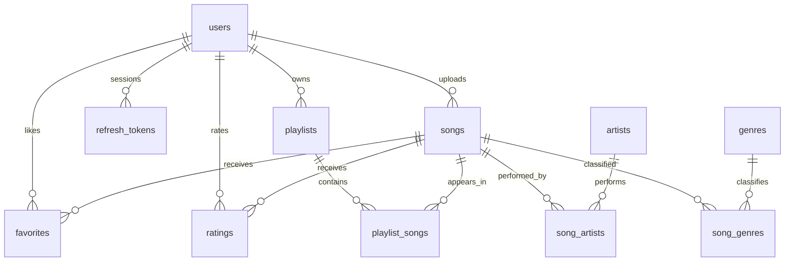

# Kiến trúc portfolio-v1

Browser gọi `/api` cùng origin → Next reverse proxy → Express modular monolith → MySQL 8. Express kiểm tra quyền/publication trước khi stream asset authenticated từ Cloudinary. Python không nằm trong đường phục vụ. HTTPS demo dùng tunnel tới web trên máy cá nhân; MySQL không mở cổng Internet.

ERD rút gọn nghiệp vụ chính (không thay thế migrations):

Listening receipts/UserActivities có event UUID/digest và transaction; refresh sessions lưu digest/rotation/revocation; upload_receipts/media_assets quản lý partial failure và quyền asset. Recommendation serving dùng recommendation_snapshots, active_snapshot và top-K neighbors theo version, tách khỏi bảng song_similarities legacy. Đây là các cơ chế bổ sung ngoài ERD rút gọn.

Nguồn đầy đủ: [baseline schema](../../Server/database/schema-v1.cjs), [migrations](../../Server/migrations), [models/associations](../../Server/src/models/index.js), [upload schema](../../Server/database/upload-schema.cjs), [API contract](../api/openapi.json), [business rules](../product/business-rules.md).

Tradeoff: giữ monolith và MySQL transactions để kiểm soát correctness; chưa có số đo cần microservices/Redis. Rebuild recommendation là maintenance command có guard/budget, không phải durable queue/scheduler. HTTPS tunnel miễn phí cần PC/Docker online, không có SLA 24/7. Backup SQL không bao gồm asset provider.
